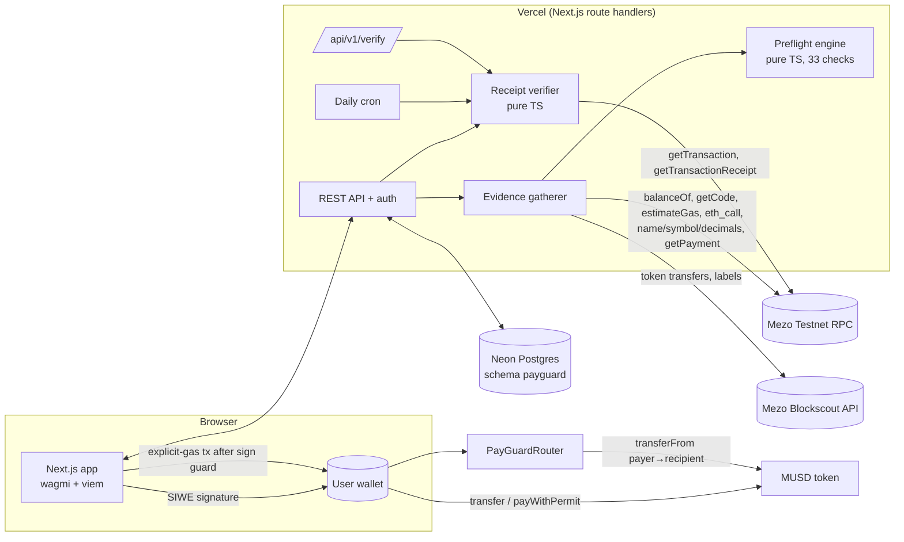

# MUSD PayGuard

**Check before you send.** A transaction-safety and payment-verification layer for MUSD on Mezo.

**Live app: https://musd-payguard.vercel.app** (Mezo Testnet, chain 31611)

| | |
|---|---|
| Health | https://musd-payguard.vercel.app/api/health |
| Public verification API | https://musd-payguard.vercel.app/developers |
| Verify any payment (no sign-in) | https://musd-payguard.vercel.app/verify |
| PayGuardRouter (deployed, **source verified**) | [`0x6EcC1672D71B5ECF58436D0f3a34A48F695dF84e`](https://explorer.test.mezo.org/address/0x6EcC1672D71B5ECF58436D0f3a34A48F695dF84e?tab=contract), deploy tx [`0xf94b13…3b0b`](https://explorer.test.mezo.org/tx/0xf94b134c8a81a2a1dfaacbee0587ccdc9f8147b624072e2ed0b8b40c56b93b0b) |
| Original product spec | [`docs/PROJECT_SPEC.md`](docs/PROJECT_SPEC.md) |

> Testnet only. Test MUSD has no monetary value. PayGuard reduces common payment mistakes; it cannot reverse a transfer or prove who controls an address.

---

## What it is

Stablecoin payments are irreversible, and most losses are ordinary mistakes made in a hurry: a mistyped or poisoned address, the wrong network, a token that only *calls* itself MUSD, an invoice paid twice, a transfer assumed to have succeeded, a fake payment screenshot.

PayGuard sits between the user and their wallet:

1. **Before signing** it gathers live evidence (balances, token contract, recipient code, gas estimate, an `eth_call` simulation, your history, on-chain counterparties) and runs a documented rules engine of **33 checks**. Every check returns `pass | warn | fail | unavailable` with severity, evidence, an explanation and a recommendation.
2. **Objective failures block sending.** Serious but inconclusive findings need an explicit acknowledgement. Checks that could not run are labelled as such, never as passes.
3. **The review is bound to a payload hash.** Right before the wallet opens, the server re-runs every check against the exact stored payload, and the browser re-derives the transaction from the reviewed payload and refuses to continue if anything differs.
4. **After signing** the hash is stored immediately (refresh-safe, idempotent, double-submit guarded). The server fetches the receipt itself and calls the payment *confirmed* only when the chain, execution status, called contract, sender and an exact MUSD `Transfer` log all match.

## What actually works (all live on testnet)

- **Wallet**: EIP-6963 multi-wallet discovery (MetaMask, Rabby, OKX…), custom connect dialog, account and network change detection, *Add Mezo Testnet* and *Add MUSD* helpers, real MUSD and BTC balances.
- **Sign-In With Ethereum** (EIP-4361): single-use server nonces with expiry, domain/URI/chain/time validation, EOA and ERC-1271/6492 signatures, HttpOnly JWT session cookie, CSRF origin checks.
- **Preflight engine** (`src/lib/engine`, pure TypeScript, UI-independent): see the [check catalogue](#check-catalogue).
- **Security review screen**: a payment manifest (grouped full address, token, network, fee ceiling, reference, payload hash), a verdict with risk category and decision rules, a gate rail, a plain-language explanation and every check with evidence. Per-finding acknowledgement checkboxes, a full-address comparison confirmation, and for large payments typing the last 4 characters of the address.
- **Real payments**: a direct MUSD `transfer` with an explicit gas limit (default), or the optional **PayGuardRouter** path: an EIP-2612 permit signature plus one `payWithPermit` transaction that records the invoice reference on-chain. The router call is simulated with the real permit before the wallet is asked to send.
- **Transaction tracking**: pending, confirmed, failed, verification delayed and unknown, with live polling, *Check now*, a daily cron safety net and in-app notifications.
- **Duplicate protection**: normalised invoice references compared with confirmed and pending payments (with *Inspect earlier payment* links), the on-chain registry, and identical recent payments flagged as medium (never blocking: recurring payments are legitimate).
- **Trusted recipient book**: add, edit labels and notes, remove, search, group-by-group address comparison, lookalike warnings on save, and immutable addresses (delete and re-add to change one). Labels are explicitly *saved by you, not verified*.
- **Payment requests**: create, share by link and QR (`/pay/<id>`), re-validated on every open (on-chain token and recipient code, expiry, status, creator), duplicate-reference protection, incoming and sent lists, cancel, and *paid* set only by a verified on-chain payment that matches the request exactly.
- **History**: filters for status, risk, recipient/reference/hash search, date range and amount range. Explorer links, CSV export (formula-injection safe).
- **Transaction details and receipts**: the checks performed before payment (review and final re-check), the verification steps after, and a printable receipt with a QR code that re-verifies live.
- **Security Centre**: the check catalogue and risk rules, recent warnings, failed validations, verification status counts, limitations and an activity (audit) log.
- **Settings**: wallet and network details, security preferences (full-address confirmation, large-payment threshold, explorer history use), notification preferences, privacy information.
- **Public verification API** `POST/GET /api/v1/verify`: structured verdicts, CORS-open, Postgres-backed rate limit of 30/min per client, docs with curl/JS/Python examples. The `/verify` page wraps it for anyone handed a "proof of payment".
- **Plain-language assistant**: deterministic explanations generated only from rule results. No external AI; it cannot add findings or soften failures.
- **Guided flow**: a Details → Review → Sign → Verify progress bar on every page of a payment; the security review leads with the checks that need attention and folds the rest into one line per group; a dashboard with quick actions, a fee-BTC warning and a setup checklist that tracks real progress.
- **Mobile**: a bottom tab bar (Home, Send, Requests, History, More) within thumb reach; every page fits a 375px screen without sideways scrolling.
- **Extras**: a ⌘K / Ctrl+K command palette and `g d`/`g s`/… shortcuts (shown on hover in the sidebar), live network status (block height, RPC health), OG/Twitter images, sitemap and robots, legal pages, 404 and error boundaries, Vercel Analytics and Speed Insights, and a landing hero that plays an example security review check by check (pure CSS, reduced-motion aware).

## How it works



**Payment lifecycle**: `draft` (DB, not a transaction) → `reviewed` (assessment bound to a payload hash) → `authorized` (server re-check passed, 10-minute window) → wallet signature → `submitted` with a transaction row in `pending` → `confirmed`, `failed`, `verification_delayed` or `unknown`. Status transitions are a closed state machine (`src/lib/engine/status.ts`); only the server-side verifier can produce `confirmed` or `failed`.

## Check catalogue

Every rule is also rendered in the app (Security Centre and Help). *Essential* checks fail safe: if they cannot run, sending is blocked.

| Rule | Check | Outcome rules |
|---|---|---|
| R-REC-01 | Address format *(essential)* | Fail: empty, missing 0x, wrong length, non-hex (with O→0 / l→1 hints), invisible/bidi characters, a name instead of an address |
| R-REC-02 | EIP-55 checksum | Fail: mixed case with an invalid checksum. Not performed: all lower/upper case |
| R-REC-03 | Unrecoverable destinations | Fail: zero/burn addresses, the MUSD contract itself, other MUSD system contracts, the router |
| R-REC-04 | Self-transfer | Warn (medium) |
| R-REC-05 | Recipient type (`eth_getCode`) | Warn (medium): contract. Warn (low): EIP-7702 delegated account. Not performed: RPC error |
| R-REC-06 | Saved recipient match | Warn (critical): differs from the selected contact's saved address. Warn (high): saved under another contact |
| R-REC-07 | Lookalike / address poisoning | Warn (critical): ≥4 leading **and** ≥4 trailing hex chars match a saved contact, past payee or on-chain counterparty but the address differs, or the address only ever sent you a zero/dust transfer. Warn (high): ≥3+3 (≥7 total) |
| R-REC-08 | First-time recipient | Warn (low): never paid and not saved |
| R-REC-09 | Explorer labels | Warn (high): Blockscout marks the address as a scam (reported as the explorer's claim) |
| R-NET-01 | Wallet network *(essential)* | Fail: any chain other than 31611. Not performed (blocks): unknown |
| R-NET-02 | Payment network *(essential)* | Fail: payload built for another chain (no fallback) |
| R-TOK-01 | Token contract *(essential)* | Fail: address ≠ configured MUSD, whatever its name |
| R-TOK-02 | Token on-chain *(essential)* | Fail: no code or name/symbol/decimals ≠ `Mezo USD`/`MUSD`/18. Not performed (blocks): unreadable |
| R-FND-01 | Amount *(essential)* | Fail: zero or invalid |
| R-FND-02 | MUSD balance *(essential)* | Fail: balance < amount (shortfall shown). Not performed (blocks): unreadable |
| R-FND-03 | BTC for fees | Fail: zero BTC or < gas limit × max fee per gas |
| R-FND-04 | Amount vs your history | Warn (medium): ≥5× median and above max (≥10× hints at an extra zero) |
| R-SIM-01 | Gas estimate | Fail: node reports a revert. Warn (low): implausibly low estimate (floor used) |
| R-SIM-02 | Simulation (`eth_call`) | Fail: reverts/returns false, with the decoded reason. Not performed: RPC error (and says so) |
| R-DUP-01 | Payment reference | Not performed (low): no reference |
| R-DUP-02 | Reference already paid | Warn (high): confirmed payment with the same normalised reference, linked for inspection |
| R-DUP-03 | Reference pending | Warn (high) |
| R-DUP-04 | On-chain invoice registry | Warn (high): `PayGuardRouter.getPayment(payer, recipient, ref)` says it was paid |
| R-DUP-05 | Similar recent payment | Warn (high): identical payment pending < 1 h. Warn (medium): confirmed < 7 days. Never blocks |
| R-REQ-01…08 | Payment request | Status, expiry (warn high), recipient (warn critical), amount (warn high, difference shown), network and token (fail), reference (warn medium), creator vs payout address (warn low) |
| R-INT-01 | Details unchanged since review *(essential)* | Fail: payload hash differs from the reviewed hash |

**Risk category and decision** (`src/lib/engine/risk.ts`):

- `R-CAT-1`: any fail gives **High risk** and sending is blocked.
- `R-CAT-2`: any essential check not performed blocks sending (fail safe); the category is at least Caution.
- `R-CAT-3`: any high or critical warning gives **High risk**, and each such warning needs an explicit acknowledgement.
- `R-CAT-4`: low or medium warnings, or a non-essential check of medium+ severity that could not run, give **Caution**.
- `R-CAT-5`: otherwise **Low observed risk**, which never means "safe".

Findings are classed as *confirmed technical failure* (fail), *suspicious pattern* (warn) or *check not performed* (unavailable), and the UI says which.

## Mezo / MUSD integration

| Contract | Address (Mezo Testnet) |
|---|---|
| MUSD (Mezo USD, 18 dec, EIP-2612) | [`0x118917a40FAF1CD7a13dB0Ef56C86De7973Ac503`](https://explorer.test.mezo.org/token/0x118917a40FAF1CD7a13dB0Ef56C86De7973Ac503) |
| PayGuardRouter (ours, current) | [`0x6EcC1672D71B5ECF58436D0f3a34A48F695dF84e`](https://explorer.test.mezo.org/address/0x6EcC1672D71B5ECF58436D0f3a34A48F695dF84e?tab=contract), deployed 2026-11-13 in block 16749291, tx [`0xf94b134c…93b0b`](https://explorer.test.mezo.org/tx/0xf94b134c8a81a2a1dfaacbee0587ccdc9f8147b624072e2ed0b8b40c56b93b0b). Source **verified** on Blockscout |
| PayGuardRouter (retired) | [`0x4523152E1033F3a095A89E7AB6f85150a154B958`](https://explorer.test.mezo.org/address/0x4523152E1033F3a095A89E7AB6f85150a154B958), block 16372387. Same source. No longer used for new payments, but its receipts still verify and its registry is still read by the duplicate check |
| MUSD system contracts (blocked as destinations) | BorrowerOperations `0xCdF7…beE5`, TroveManager `0xE47c…6bb0`, PriceFeed `0x86bC…9366`, StabilityPool `0x1CCA…680e`, HintHelpers `0x4e4c…BCF6`, SortedTroves `0x722E…68fA`, InterestRateManager `0xD4D6…7f37` |
| Mainnet MUSD (reference only, never used) | `0xdD468A1DDc392dcdbEf6db6e34E89AA338F9F186` |

Network config lives only in `src/config/chains.ts` and contract config only in `src/config/contracts.ts`. RPC `https://rpc.test.mezo.org`, explorer `https://explorer.test.mezo.org`, Blockscout API `https://api.explorer.test.mezo.org/api/v2`.

**Gas policy (Mezo-specific)**: the testnet enforces the EIP-7623 calldata floor and the public RPC has returned implausible estimates. Every write therefore sends an explicit `gas = max(estimate × 1.3, floor)` (90k transfer/approve, 250k `pay`, 300k `payWithPermit`), and estimates below 30k/60k are treated as invalid. Mezo bills at least half the gas limit, so the UI shows the fee as a ceiling.

### PayGuardRouter (optional, non-custodial)

`contracts/contracts/PayGuardRouter.sol`, Solidity 0.8.28, london, OpenZeppelin 5.1. No owner, no admin, no fees, holds no funds.

- `pay(to, amount, invoiceRef)` and `payWithPermit(…, deadline, v, r, s)` (permit in try/catch, front-run safe) move MUSD payer → recipient with `safeTransferFrom` in one transaction.
- Records `payments[keccak256(payer, recipient, invoiceRef)]`, so a second payment of the same reference **by the same payer** reverts `AlreadyPaid`, from any device or app.
- **Design choice**: duplicate keying is per payer, not `paid[recipient][ref]` as first sketched. A global key would let a stranger front-run a dust payment with someone's invoice reference and block the real payer (griefing). Merchants get a griefing-resistant aggregate instead: `totalPaidTo[recipient][ref]` (compare with the invoice amount) and the `InvoicePaid(payer, recipient, invoiceRef, amount, totalPaidForRef)` event.
- Invoice reference = `keccak256(utf8(NFKC(ref).trim().collapseSpaces().toUpperCase()))`, shared by the app, the contract tests and the API.
- Rejects the zero address, the router, the token and self as recipients, zero amounts and empty references. No `receive`/`fallback`.
- The current deployment's source is **verified on Blockscout** (`is_fully_verified: true`, solc 0.8.28, london, 200 runs). The first deployment could not be verified at the time; it is kept as a retired router (`PAYGUARD_ROUTER_LEGACY` in `src/config/contracts.ts`) so receipts for payments made through it still verify, and both addresses are blocked as payment destinations. The standard-JSON input is in `contracts/verification/`.

## Tech stack

Next.js 16 (App Router, Turbopack) · React 19 · TypeScript 5.9 strict · Tailwind CSS 4 · Radix primitives (hand-styled) · wagmi 2 + viem 2 + TanStack Query 5 · Neon Postgres (`@neondatabase/serverless`, raw SQL) · jose (JWT) · zod 4 · cmdk · sonner · qrcode.react · Vitest 3 · Hardhat 2 + OpenZeppelin · Vercel (functions, cron, analytics).

Typography: Archivo with its width axis (expanded for display) for an instrument-panel voice, plus JetBrains Mono for addresses and hashes, grouped in 4-character blocks for comparison. Palette: navy-black hull, signal cyan for actions, restrained violet for on-chain/registry. Status is never colour-only: each state has its own icon shape (circle-check, triangle, octagon, dashed circle) and a text label.

## Database (Neon Postgres, schema `payguard`)

`db/migrations/001_init.sql` (idempotent, `npm run db:migrate`):

| Table | Purpose |
|---|---|
| `users` | One row per SIWE-verified wallet (address unique) + settings JSON |
| `auth_nonces` | Single-use SIWE nonces with expiry |
| `recipients` | Trusted recipient book; unique (user, chain, address) |
| `payment_requests` | Shareable requests; unique live invoice ref per creator |
| `drafts` | Unsigned payments (never transactions); status, payload hash, acknowledgements |
| `assessments` | Every preflight and final re-check, stored in full (JSON) |
| `check_results` | Flattened non-passing results for the Security Centre |
| `transactions` | Submitted txs; **`tx_hash` UNIQUE**, `draft_id` UNIQUE, status, verification JSON |
| `notifications`, `audit_events`, `rate_limits`, `schema_migrations` | In-app updates, audit trail, public API limits |

## Security model

- **Non-custodial**: no keys, no seed phrases, nothing signed for the user. The router never holds funds and has no owner.
- **Wallet ownership**: SIWE with server nonces (single use, 10-minute expiry, consumed atomically), domain, URI, chain and time checks. HS256 JWT in an HttpOnly, SameSite=Lax (Secure in production) cookie. Every route enforces the session owner (another wallet gets 404).
- **Forged and replayed requests**: Origin/Referer check on every cookie-authenticated write; replayed SIWE messages are rejected; zod validation and size caps on every input.
- **Never trusting the client**: payment details for a transaction come from the server-side draft, never the client. Status comes only from the server's own receipt verification. A tx hash is unique across all payments, and a draft accepts exactly one hash (idempotent re-submits are allowed).
- **Review integrity**: a payload hash binds the review; editing resets it; authorization re-runs every check with the reviewed hash. The browser sign guard (`src/lib/engine/sign-guard.ts`) decodes the calldata and compares recipient, amount, token, chain, sender and router reference with the reviewed payload before the wallet opens.
- **Fail safe**: unreadable token, balance or network blocks sending. RPC outages produce *verification delayed*, never success.
- **Secrets**: `SESSION_SECRET` and `CRON_SECRET` exist only in Vercel env. The deployer key is read at runtime from outside the repo and never copied; test-wallet keys are read at runtime by the e2e script only. `.gitignore` and `.vercelignore` exclude `.env*`, key material and build output.
- **Headers**: HSTS, `X-Frame-Options: DENY`, `nosniff`, a strict referrer policy and a permissions policy.

## Testing

| Suite | Command | Latest result |
|---|---|---|
| Unit (engine, verifier incl. retired-router receipts, sign guard, amounts, refs, status machine, gas policy, DB retry rules) | `npm test` | **119 passed** (5 files) |
| Contract (Hardhat) | `cd contracts && npx hardhat test` | **23 passing** |
| Type check / lint / build | `npm run typecheck`, `npm run lint`, `npm run build` | 0 type errors, 0 lint errors (4 warnings), build OK |
| Live e2e on Mezo Testnet, unfunded mode, vs a local **production build** (2026-11-13, new router) | `TEST_WALLETS_FILE=… E2E_BASE_URL=http://localhost:3000 npm run e2e:testnet` | **50 passed, 0 failed**; real-transfer steps skipped (no test MUSD) |
| Live e2e on Mezo Testnet, funded mode, vs **production** (2026-10-26, first router) | `E2E_BASE_URL=https://musd-payguard.vercel.app npm run e2e:testnet` | **65 passed, 0 failed** |

The live e2e (`scripts/e2e-testnet.ts`) reads two keys from `TEST_WALLETS_FILE` (`{"payguard":[{"role":"alice","privateKey":"0x…"},{"role":"bob",…}]}`, kept outside the repo) and picks a mode from alice's MUSD balance.

**Unfunded mode** (alice holds < 4 MUSD) sends no transaction at all. It checks the new router's code, token and explorer verification; real-balance preflights and every structural check; that the server refuses blocked, unreviewed and stale payments; session isolation; lookalike, checksum, wrong-chain and router-as-recipient blocks; payment requests; `payWithPermit` simulated with a real permit signature (it passes the allowance and stops at the balance); and the public API against earlier real payments, including one made through the retired router, down to a 1-wei amount difference.

**Funded mode** (alice holds ≥ 4 MUSD, spends about 3) additionally walks spec §22 with real payments:

- Health; 401 when unauthenticated; SIWE replay rejected; CSRF rejected.
- Bob saved as a recipient; alice's real balance read by the preflight.
- A duplicate invoice reference flagged (High risk, acknowledgement required, linked to the earlier payment); signing refused without the acknowledgement.
- Editing invalidates the review; signing with the old reviewed hash refused; the corrected payment passes.
- A real 2 MUSD transfer with explicit gas, its hash recorded, and the server verifying the receipt and Transfer log as confirmed.
- Idempotent re-submit; a second hash and a reused hash rejected; an authorized-but-unsigned payment records no transaction; status survives a new session.
- Public API: verified, wrong amount, wrong recipient and unknown hash.
- Blocked: invalid address, wrong chain, bad checksum, the token contract as recipient, insufficient balance (with the decoded revert). A lookalike address is flagged critical. Another wallet cannot read alice's payment.
- Payment request → **real PayGuardRouter `payWithPermit`** → InvoicePaid verified → request marked paid → `isPaid` on-chain → API proves the invoice reference; a second payment of the same invoice is flagged and reverts `AlreadyPaid` in simulation.

**Real transactions from the e2e runs** (all verified as confirmed by the app):

| Run | Purpose | Tx |
|---|---|---|
| production | corrected 2 MUSD direct payment | [`0xbae1ee76…a95b2c`](https://explorer.test.mezo.org/tx/0xbae1ee76315a66277c252bda7f951c350f6b605cc7e7f00f7ba15256d4a95b2c) |
| production | 1 MUSD PayGuardRouter `payWithPermit` (request `REQ-MVPC07MU`) | [`0x4139a5a1…1accfc`](https://explorer.test.mezo.org/tx/0x4139a5a1c5e4adf5701dd29eb68e74957a04d97326935dc14dc8b75ff41accfc) |
| production | reused as the "previously confirmed" invoice | [`0x7a9571b7…c49e9b`](https://explorer.test.mezo.org/tx/0x7a9571b713739c53a00ccdcaa92c9fd353dba07c971a3ee80c07c06df7c49e9b) |
| local | 2 MUSD direct + 1 MUSD router | [`0x7a9571b7…`](https://explorer.test.mezo.org/tx/0x7a9571b713739c53a00ccdcaa92c9fd353dba07c971a3ee80c07c06df7c49e9b), [`0xb7af4b05…`](https://explorer.test.mezo.org/tx/0xb7af4b0596701076e40a454f9d23e2dfa0cf2c3e09b770de08361b53305cdc14) |
| local | first payments (1 + 2 + 1 MUSD) | [`0x38853c8a…`](https://explorer.test.mezo.org/tx/0x38853c8a9fc502620ed684f029960be634ed7e7c0a92a9da426e8aa2818ff0c9), [`0x96475303…`](https://explorer.test.mezo.org/tx/0x9647530331c5a1e64d70a016a07339ca7906f9e23e354709de7a61f8cc803d2f), [`0x35914cbe…`](https://explorer.test.mezo.org/tx/0x35914cbe9c12dc5e686cdc8ea09dcc22ea637d3eb0ec5c3e103d472a7aa5100b) |

## Local setup

```bash
npm install
vercel link --yes --project musd-payguard && vercel env pull .env.local --yes   # or copy .env.example
npm run db:migrate
npm run dev            # http://localhost:3000
npm test
```

Environment (see `.env.example`): `DATABASE_URL`, `SESSION_SECRET` (48+ random bytes), `CRON_SECRET`, plus optional `NEXT_PUBLIC_SITE_URL` and `MEZO_RPC_URL`. The e2e script reads `TEST_WALLETS_FILE` and `E2E_BASE_URL` at runtime.

Contracts: `cd contracts && npm install && npx hardhat test`. To deploy, put `PRIVATE_KEY=0x…` in `contracts/.env.deployer` (git-ignored) or point `DEPLOYER_ENV_FILE` at another file, then run `npx hardhat run scripts/deploy.ts --network mezotestnet`. It sanity-checks the MUSD token, sets an explicit gas limit, retries on nonce errors, verifies `token()` after deployment and records the previous deployment under `previousDeployments`. Verify the source with `npx hardhat verify --network mezotestnet <address> 0x118917a40FAF1CD7a13dB0Ef56C86De7973Ac503`, then update `PAYGUARD_ROUTER` (and move the old one to `PAYGUARD_ROUTER_LEGACY`) in `src/config/contracts.ts`.

Deploy: `vercel deploy --prod --yes`. `vercel.json` pins the Next.js framework and a daily cron (`0 6 * * *`, `CRON_SECRET`-protected) that re-verifies unresolved payments.

## Demo script (about 2 minutes)

1. **Setup**: in MetaMask or Rabby, open https://musd-payguard.vercel.app and press *Connect wallet*; PayGuard offers to add Mezo Testnet. Get testnet BTC for fees from https://faucet.test.mezo.org/ and test MUSD from the Mezo app (borrow against BTC) or a teammate.
2. **Sign in** (a free signature) and open the **Dashboard**: your real MUSD balance and BTC for fees.
3. **Recipients**: save a teammate's address. Paste a lookalike into *Compare an address*; the differing groups light up.
4. **Send MUSD**: choose the contact, enter `2`, reference `INV-0042`, then *Run security review*. Every check runs with evidence. Pay it; your wallet shows a plain MUSD transfer with an explicit gas limit. Watch *Pending* become *Confirmed* with the verification steps, and open the **Receipt**.
5. **Send again** with reference `inv-0042`: *Possible duplicate payment*, High risk, *Inspect earlier payment*, and the confirm button stays disabled until you acknowledge. Change the reference and it passes.
6. **Failure handling**: switch the wallet to another network (the banner appears and the review blocks), or enter `0x123` (blocked). Press *Confirm and sign*, then **reject in the wallet**: "Nothing was signed or sent".
7. **Requests**: create one, scan the QR, open `/pay/<id>`, pay with *Transfer and record invoice on-chain* (permit + one tx). The request turns *Paid*.
8. **Verify**: paste the tx hash into `/verify` with a wrong amount (*Does not match*), then the right one (*Payment verified*).

## Known limitations (honest)

- PayGuard cannot know who controls an address, cannot reverse transfers, and cannot stop a transaction after the wallet approves it.
- Duplicate detection sees PayGuard records and the router registry only; direct payments made outside PayGuard are invisible to it. A direct transfer carries no on-chain invoice reference (the router path does).
- Lookalike detection compares against saved contacts, PayGuard history and the latest 50–100 on-chain MUSD transfers from Blockscout. Attackers who never touched your history are not caught by it.
- Simulation uses the public RPC at the latest block. For router payments, the preflight simulates the transfer leg, and the exact `payWithPermit` call is simulated in the browser after the permit signature.
- Background verification runs **once per day** (Vercel Hobby cron); while a payment page is open it polls every 4 s, and *Check now* forces a check.
- The public Mezo RPC is load-balanced and can briefly return a mined transaction without its receipt; the verifier retries, then reports *pending* rather than guessing.
- Rejecting a signature in a real wallet is handled in the UI (`UserRejectedRequestError`, code 4001) but cannot be automated in the e2e. The e2e instead asserts that an authorized-but-unsigned payment records nothing.
- The PayGuardRouter is unaudited (its source is verified on Blockscout). The direct-transfer path does not depend on it.
- Notifications are in-app only (no email or webhooks yet). One user corresponds to one wallet.
- The database connection retries transient network failures only where it is provably safe (connection never opened, or a read-only query); a write interrupted mid-request fails with a clear error rather than risk running twice.

## Pitch and roadmap

**Pitch**: every MUSD payment should get the same pre-flight a pilot runs before take-off. PayGuard turns "I hope that's the right address" into a checklist with evidence, refuses to let objective mistakes through, and ends the screenshot era of payment proof: a payment is confirmed when the chain says so, and anyone can check.

**Roadmap**

1. Merchant webhooks (`payment.confirmed`) and an embeddable review component for checkouts.
2. A TypeScript SDK wrapping `/api/v1/verify` and the engine, so wallets can run the same preflight locally.
3. Router v2: per-request expected amount and expiry committed on-chain by the merchant (EIP-712 invoice signatures).
4. Shared opt-in address reputation (reported poisoning addresses), always attributed and never presented as proof.
5. Mainnet support after an audit, with per-chain configuration (mainnet MUSD `0xdD46…F186` is already recorded but deliberately unused).
